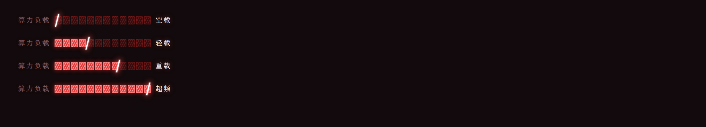

# dsh-cyber-red-load

把 DSH 模型弹层里的「推理等级」搬到输入框底部，做成常驻的 **算力负载** 四档滑动条——
点一下、拖一刀、按 ←/→ 都能换档，配色沿用
[dsh-cyber-red-ui](https://github.com/huzhengcai471-crypto/cyber-red-ui) 的红黑主题。



| 档位 | 原生 id | 含义（来自 `@deepseek-ai/dsh-llm-deepseek`） |
| --- | --- | --- |
| 空载 | `off` | 简单任务，不需要推理 |
| 轻载 | `low` | 例行任务、对延迟敏感 |
| 重载 | `high` | 大多数任务的默认平衡 |
| 超频 | `max` | 最难、质量优先的任务 |

## 行为

- 注册在 `conversation.input.left` 插槽：输入框底部工具行，`+` / 权限 / 计划 之后，始终可见。
- 12 格 HUD 分段条：每档 3 格，点亮的格子跟着当前档位；交界处一根白色斜竖标指示落点，
  拖动时跟手预览档位名，**松手才提交一次** `selectModel`；提交后本地先停在目标档，
  等宿主确认再对齐，不会弹回旧档。
- 键盘：`←`/`→`/`↑`/`↓` 逐档，`Home`/`End` 到首尾；`role="slider"` + `aria-valuetext`
  暴露中文档位名，读屏可用。
- 状态直接读 `ctx.modelDirectories.directoryFor(sessionId)` 的会话级目录（和官方模型选择器
  同一份数据），写入走 `directory.select({ provider, model, reasoningEffort })`。
- 非推理模型、subagent 会话、目录未就绪时自动不显示，不占位。
- 原生弹层里「推理等级 / Reasoning effort」那一行由 DOM 观察器隐藏（按可见文案匹配，
  不依赖 CSS module 哈希，DSH 小版本升级一般不会失效）。
- 模型按钮上残留的英文档位名（`Low` / `High` …）就地换成中文档位名；React 重渲染后会再次纠正。

## 安装

需要 DSH `>= 0.2.0-rc.1`、Node `>= 20`，零运行时依赖。

```powershell
# 1) 从 GitHub 装进 profile（只写 dependencies）
dsh plugin --profile desktop add github:Eason-zys/dsh-cyber-red-load

# 2) 再把包名写进 profile 的 dsh.profile.bundles，否则装上也不生效
#    编辑 C:\Users\<你>\.dsh\profiles\desktop\package.json，在 dsh.profile.bundles 末尾加：
#    "dsh-cyber-red-load"
```

改完保存即可，运行中的 DSH 会热加载（HMR），然后 `Ctrl+R` 刷新页面。

手工安装（没有 `dsh` CLI 时）等价于两步：把本仓库复制到
`~/.dsh/profiles/<profile>/node_modules/dsh-cyber-red-load`，再按上面的方式加依赖与 bundles。

## 卸载

从 `dsh.profile.bundles` 里删掉 `dsh-cyber-red-load` 并刷新即可；本插件不修改任何 DSH 核心文件。

## 兼容性

- 需要 `@deepseek-ai/dsh-client-ui-conversation` 提供 `conversation.input.left` 插槽；
- 需要 `modelDirectories` 服务（`@deepseek-ai/dsh-client-ui-model-selection` 提供）与 `sessions` 服务；
- `cordis.patch.yml` 只插入一行插件条目；宿主侧 `lib/index.js` 是空 `apply`，所有行为在
  `lib/client.js`（浏览器端）。

## License

[MIT](LICENSE)
